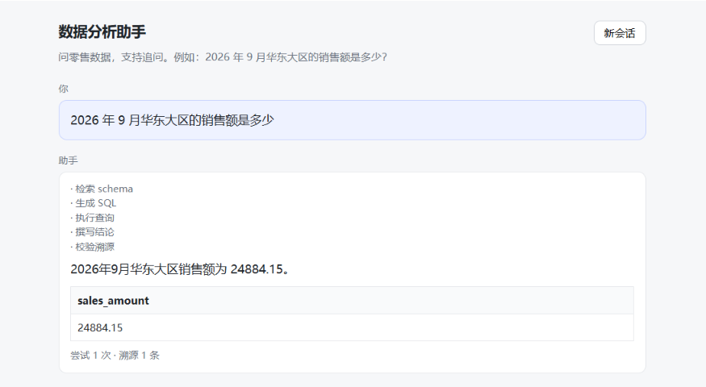

# 零售数据分析 Agent：每个数字都要有出处


用自然语言问零售数据。Agent 把问题翻译成一条只读 SQL，执行后给出中文结论——**结论里的每个数字都必须能追溯到结果集的某一格**，追溯不到就降级成纯表格，不编。

难的不是写 SQL，是 SQL 写错了不会报错：它照样返回一个看起来完全合理的数字。

多轮追问会继承上文："那华南呢？"这句话里既没有时间也没有指标，系统照样答出华南 9 月的销售额。

**在线演示**：<https://data-analysis-agent-9q2v.onrender.com>　Render 免费层，15 分钟无请求会休眠，首次访问需等待约 50 秒冷启动。



- **数字溯源**：回答里的每个数字都要在结果单元格里找到出处，否则整段降级为表格；`degraded` 的三种原因（溯源失败 / 写答案的模型失败 / 三次查不出来）分开上报
- **只读防护**：四道硬拦截（只读连接 / SELECT·WITH 白名单 / 关键字黑名单 / 多语句），外加 1000 行上限与 5 秒超时
- **工具层隔离（MCP）**：两个 stdio Server，应用进程里**没有数据库路径，也没有连接对象**
- **六节点图**：`retrieve_schema → generate_sql → execute_sql → route → build_answer → verify_citations`，出错回填重试，硬上限 3 次；**走哪条路是代码决定的，不是模型决定的**
- **多轮**：`AsyncSqliteSaver` 按 `session_id` 持久化，最近两轮 `(问题, SQL)` 进 prompt
- **口径常驻 + 检索只负责长尾**：三块核心口径恒定拼进上下文；`schema.md` 切 22 块，bge-m3 召回 top 10、重排取 top 5。对照实验：口径值 13–14 题，长尾材料值 2–3 题——而整份文档全塞也是 20/20，检索在这个规模省的是 token，不是准确率
- **L3 外壳**：API key 鉴权、IP 限流、`request_id` 结构化日志、Prometheus 指标
- **评测**：20 题单轮（含「口径常驻但不检索」的对照组）+ 50 轮多轮；判定器坏过一次——每行只比第一列，旧数字全部作废重跑

这份 README 最值得看的是第 11、12、13 次迭代：三次都是我自己的数字在骗我。

**技术栈**：Python 3.13 · FastAPI · LangGraph · RAG · MCP · DeepSeek · bge-m3 · bge-reranker · SQLite · Prometheus · pytest

## 目录

| 想了解什么 | 看这一节 |
|---|---|
| 5 分钟跑起来 | [快速开始](#快速开始)；完整步骤见 [docs/quickstart.md](docs/quickstart.md) |
| 上线到 Render | [部署](#部署)；完整步骤见 [docs/deploy.md](docs/deploy.md) |
| 分成哪几层、一次请求怎么走 | [架构](#架构) |
| 每个选择为什么这么做、代价是什么 | [设计决策](#设计决策) |
| 8 个端点和状态码 | [接口](#接口)；示例与 SSE 事件见 [docs/api.md](docs/api.md) |
| 六组实验数字、判定规则、失败分析 | [评估](#评估) |
| 出错时系统怎么表现 | [故障处理](#故障处理) |
| 17 条已知局限，每条都写了该怎么改 | [已知局限](#已知局限) |
| 十三次迭代：十二次「没有报错但结果是错的」 | [迭代记录](#迭代记录)；第 1–10 次见 [docs/iterations.md](docs/iterations.md) |

## 快速开始

> 需要 Python 3.13。下面命令是 Windows PowerShell 写法；Linux/macOS 把路径换成对应的即可。

```powershell
git clone https://github.com/YuYuYu-333/data-analysis-agent.git
cd data-analysis-agent
python -m venv .venv
.\.venv\Scripts\Activate.ps1
pip install -r requirements-dev.txt
Copy-Item .env.example .env      # 填 DEEPSEEK_API_KEY 和 SILICONFLOW_API_KEY
.venv\Scripts\python.exe scripts\generate_data.py
.\scripts\start.ps1
```

打开 <http://127.0.0.1:8000> 直接用页面问；接口文档在 `/docs`。

`start.ps1` 会先检查 `.venv`、`.env`、`data\retail.db` 三样东西，缺哪个就打印该跑的修复命令再退出——而不是让新人对着一个 import 栈发呆。

`pytest` 跑 116 个测试，不调真实模型、不需要网络。CI 在干净的 Ubuntu + Python 3.13 上重跑同一套，跑之前先用固定种子生成 `retail.db`——`*.db` 不进仓库，不生成的话 5 条执行路径会一直 skip。

`.env` 每个变量的含义、测试与评测怎么跑、PowerShell 执行策略和 Windows 上的坑：**[docs/quickstart.md](docs/quickstart.md)**。

## 部署

目标平台是 Render 免费层，仓库根目录的 `render.yaml` 就是 Blueprint：导入、在 Dashboard 填三个环境变量、部署。

**密钥只填在 Dashboard 里，不要写进仓库。** 启动命令必须先跑 `generate_data.py`——`retail.db` 不进仓库，容器每次重建都是干净的。

完整步骤、`/ready` 的验证方式、免费层的两个已知现象和冷启动失败的排查路径：**[docs/deploy.md](docs/deploy.md)**。

## 架构

### 分层

| 层 | 文件 | 职责 |
|---|---|---|
| HTTP 层 | `app/api.py` | 路由、鉴权、限流、中间件、指标。**全项目唯一知道 HTTP 存在的文件** |
| 图编排层 | `app/graph.py` | 六个节点、条件边、prompt |
| 纯粹逻辑 | `app/answer.py` | 表格格式化与溯源校验，纯函数，不碰网络和数据库 |
| 工具客户端 | `app/mcp_client.py` | 拉起两个 MCP Server，持有常驻会话 |
| 工具实现 | `mcp_servers/*.py` | schema 检索、只读 SQL 执行、四道拦截 |
| 基础设施 | `app/llm.py` / `checkpointer.py` / `config.py` / `logging.py` / `limits.py` | 客户端、持久化、配置、日志、限流 |

依赖方向单向向下，`answer.py` 只 import 标准库——所以它是全项目测试最密的文件。

**这条约束换来一件事**：溯源逻辑能脱离模型单测。`find_citations()` 收三个参数、返回两个列表，测试可以直接喂 `"比 8 月少了 2445.54"` 和 `[[-2445.54]]` 看它认不认。

### 一次请求的完整流程

```
POST /demo/analyze  { question, session_id }
  │
  ├─ 中间件：生成 request_id → set 进 contextvars → 开始计时
  ├─ 限流：最近 60 秒内该 IP 是否已满 5 次 → 满了 429
  │
  ├─ analyze(question, session_id)      session_id 即 LangGraph 的 thread_id
  │    │
  │    ├─ retrieve_schema   列名与三块核心口径恒带；MCP 再检索 top 5 长尾小节
  │    ├─ generate_sql      带 schema + 最近两轮 + 上次 error
  │    ├─ execute_sql       MCP → execute_readonly_sql
  │    │
  │    ├─ route  ── 有错且 attempts < 3 ──→ 回到 generate_sql
  │    │         ├─ 有错且 attempts >= 3 ──→ give_up（如实说查不出来 + 最后一条错误）
  │    │         └─ 无错 ─────────────────→ build_answer
  │    │
  │    ├─ build_answer      基于结果集写一句话
  │    └─ verify_citations 每个数字找出处；找不到 → 整段换成表格，degraded=true
  │
  ├─ 记录指标与日志（tokens / attempts / 是否降级）
  └─ 返回 JSON + X-Request-ID 响应头
```

**重试带的是信息，不是运气**：回填给 `generate_sql` 的是数据库原文错误（`no such column: sale_date`），不是「再生成一次」。这条错误本身就是最强的提示。

**溯源的结果是降级而不是报错**：模型说了个结果集里没有的数字，用户需要的仍然是一份可用的答案——所以把自然语言换成纯表格，并且明确标记 `degraded=true`。宁可难看，不可失真。

<details>
<summary><b>目录结构</b>（点开）</summary>

```
data-analysis-agent/
├── app/
│   ├── api.py            FastAPI：路由、鉴权、限流、中间件、指标
│   ├── models.py         Pydantic 请求/响应模型
│   ├── graph.py          六节点图 + prompt
│   ├── state.py          AnalysisState（trace / tokens 每轮从 0 开始）
│   ├── answer.py         格式化与溯源校验（纯函数）
│   ├── mcp_client.py     两个 MCP Server 的常驻会话
│   ├── checkpointer.py   AsyncSqliteSaver 工厂
│   ├── llm.py            DeepSeek / SiliconFlow 客户端
│   ├── limits.py         滑动窗口限流
│   ├── logging.py        JSON 日志 + request_id contextvar
│   ├── session_lock.py   会话级串行锁（引用计数回收）
│   ├── config.py         环境变量 + import 期校验
│   ├── rerank.py         cross-encoder 重排（生产链路）
│   ├── bm25.py           BM25 召回（评测候选，生产未启用）
│   └── hybrid.py         RRF 融合（评测候选，生产未启用）
├── mcp_servers/
│   ├── schema_server.py  22 块 schema 检索（bge-m3 召回 + 重排，失败降级）
│   └── db_server.py      只读执行 + 四道拦截 + 资源限制
├── scripts/
│   ├── generate_data.py  生成 retail.db（固定种子）
│   └── start.ps1         本地一条命令
├── eval/
│   ├── questions.jsonl   20 会话 / 50 轮
│   ├── run_eval.py       采集：跑题、比对、写 raw-*.json
│   ├── judge.py          结果集规范化与比对
│   ├── retrieval_questions.jsonl  48 道检索题
│   ├── retrieval_eval.py  检索层评测（六种方案对比）
│   └── report.md         分析报告
├── docs/
│   ├── quickstart.md     安装、配置、测试与评测的完整步骤
│   ├── deploy.md         Render 部署、免费层限制、冷启动排查
│   ├── api.md            请求/响应示例、字段表、SSE 事件
│   └── iterations.md     第 1–10 次迭代的完整复盘
├── web/
│   └── index.html        单页 UI（无构建、无 CDN）
├── tests/                116 个测试
└── data/
    ├── schema.md         表结构 + 业务口径（提交）
    └── retail.db         生成物（不提交）
```

</details>

## 设计决策

### 1. 必需项和可选优化分开处理

`app/config.py` 在 import 阶段检查两个模型密钥，缺一个直接 `RuntimeError`。而 `API_KEY` 故意不检查——没配时 `/analyze` 返回 503「服务未配置」，`/demo` 和评测脚本照常能用。

判据：**缺了它，程序还有没有一条正确的运行方式？**

没有模型密钥，整个系统没有任何可用路径，早崩比晚崩好；没有 API key，公开演示和本地评测都正常，只是正式接口关着门。把可选的东西设成准入条件，会让新克隆仓库的人连 `pytest` 都跑不起来。

**代价**：`import app.api` 本身要求密钥齐全，所以跑单元测试也得先有 `.env`。CI 里塞两个 `dummy` 值绕过——测试本来就不调真实模型。

### 2. 判定器宁可放过形状差异，不放过错答案

参考结果和模型结果比对时，最初用「排序后逐位相等」。结果 E08 和 E20 一题判错一题判对，仔细看是同一个问题：模型多带了一列 `product_id`。

先改题库（去掉多余列），E20 又反过来失败——模型自己把那一列加回来了。**这说明问题不在题，在尺子。**

改成多重集包含：候选行必须覆盖参考行里的每个值，允许候选多出列；行数必须相等。

**代价**：判定变宽松了，"多返一列无关信息"不再算错。这是有意的取舍——SQL 的列数是表达习惯，不是正确性。行数仍然严格，因为行数多一行少一行通常意味着筛选条件错了。

**这条规则第一次实现时是错的**：`return True` 缩进在循环里，每行只比了第一个值。规则本身没问题，问题在实现——而且单测只覆盖了单列表，恰好绕开它。见迭代 11。

### 3. MCP 客户端用常驻会话，不是每次 `get_tools()`

`langchain-mcp-adapters` 的 `MultiServerMCPClient.get_tools()` 返回的工具，**每次调用都会新起一个子进程**。后果有两个：

一是慢——`schema_server` 启动时要给 22 个块做 embedding，每题重跑一遍，50 道题就是 1100 次向量调用；
二是退出时 Windows 卡在 `process.wait()`，终端 Ctrl+C 都出不来。

改成 `client.session(name)` + `load_mcp_tools(session)`：启动时连一次，全程复用。

**代价**：会话和事件循环任务绑定了。anyio 规定 cancel scope 必须在进入它的同一个任务里退出，而 LangGraph 的节点跑在子任务里——在节点里第一次连接，收尾时就会报 `Attempted to exit cancel scope in a different task`。所以必须在 `run()` 或 `lifespan` 这种「主任务」里显式调用一次 `connect()`。这条约束写在了函数 docstring 里。

### 4. 溯源允许符号翻转，也豁免日期

`verify_citations` 在回答里找数字，逐个去结果集里找出处。三条例外是后来加的：

- **符号翻转**：单元格是 `-2445.54`，回答里写「比 8 月少了 2445.54」。人说话不带负号，这是同一个数。
- **日期**：`2026-09-04`、`2026/9/4`、`2026年9月` 整体跳过——先识别日期占用的字符区间，落在区间里的数字一个都不拆出来。
- **问题里已有的数字**：用户问「9 月」，回答里出现 9 不算编造。

判断"数字后面是不是跟了 年/月/日"时，**必须先判空串**。句尾没有标点时，`after` 是 `""`，而 `"" in "年月日号"` 恒为 `True`——所有以数字结尾的句子都会被当成日期放过。见迭代 12。

**代价**：放宽之后，理论上「把 -5 说成 5」这种真正的符号错误不会再被抓住。判断依据是——溯源要回答的是「这个数有没有出处」，不是「正负说没说明白」。

### 5. 多轮靠 prompt 规则继承，不靠模型自觉

50 轮评测里曾有 8 条多轮题失败，其中 6 条是同一个原因：追问时把上一轮的时间范围丢了。「那华南呢？」——模型生成了一条不带 `order_date` 过滤的 SQL，答的是全时段。

修法是在 `SYSTEM_PROMPT` 里加一条硬规则：

```
5. 这是多轮对话：新问题没有重新限定时间时，必须沿用上一轮 SQL 的时间范围；
   其他筛选条件（大区 / 渠道 / 品类 / 状态）同理，除非新问题明确改掉或扩大范围。
```

修完这几条转绿。

**代价**：这是软约束，模型仍可能偶尔无视。真正硬的方案是把上一轮 SQL 的结构化条件提取出来拼进 prompt，或者做查询重写——工程量高一个数量级，留作已知局限。

### 6. 限流放在进程内存，接受单实例语义

滑动窗口用 `deque` 存每次请求的时间戳，超过 60 秒的丢掉。放内存而不是 Redis，因为部署目标是单实例。

**为什么不用「每分钟清零一个计数器」**：清零式在第 59 秒打满、第 61 秒再打满，两秒内实际放行两倍。滑动窗口在任何 60 秒区间内都不超限。

**代价**：重启归零；多实例各算各的。这两条都写进了已知局限——达到 L4 之前不值得引入 Redis。

### 7. `request_id` 用 contextvars 贯穿，而不是层层传参

每个请求生成一个短 id，`set` 进 `ContextVar`。`JsonFormatter` 每次格式化都去取值，所以该请求整条调用链上的日志自动带上同一个编号，路由函数、节点函数都不用改签名。

响应头 `X-Request-ID` 把它交给客户端——用户报错时贴这一串，日志里一搜就是完整现场。

**代价**：`ContextVar` 跟着异步任务走，跨 `to_thread` 会丢。项目里没有这种用法，但一旦引入线程池就需要额外传递。

### 8. RAG 的语料是 schema 和业务口径，不是文档

这个项目里的检索增强不是"文档问答"，语料是 `data/schema.md`：四张表的列与类型、业务口径（销售额 = `SUM(amount - refund_amount)`、退款率的分母是明细行数、环比按自然月）、以及四个已知陷阱（`LEFT JOIN` 放大行数、取消订单要不要计入、退款是否重复扣减）。

**流水线**：

```
schema.md  →  切成 22 块  →  bge-m3 向量化（启动时一次）  →  内存中的 22 个向量
                                                                    │
问题  →  embedding  →  余弦相似度  →  top 10 候选  ─────────────────┘
                                        │
                                        ▼
                          bge-reranker-v2-m3 重排  →  top 5 块
                                        │
                                        ▼
                          拼进 generate_sql 的 prompt
```

**三块核心口径是常驻的，不靠检索。** 每次请求的上下文里都带着销售额、订单数、客单价三条口径：内容是 `schema.md` 8.1–8.3 的副本，硬编码在 `app/graph.py` 的 `CORE_METRICS` 里（两份文本可能漂移，见已知局限）。检索只负责长尾：枚举值、退款率、已知陷阱。

这不是拍脑袋。判定器修好后重跑，单轮从 100% 掉到 75%；6 道稳定失败逐条查 SQL，全是漏了「销售额要减退款」「订单数只算 completed」——而这三块口径**一块都没进 top 5**，模型从头到尾没看见规则。

原因在评测的粒度：检索评测问的是「目标小节排第几」，答题需要的是「表结构 + 口径 + 陷阱」的组合。一块目标小节进了前 5，不代表答题需要的材料齐了。

**口径、长尾材料、检索选择，三样分开量过。** 加了两组对照：`core`（列名 + 三块口径，不调检索）、`full`（列名 + 整份 `schema.md`，不调检索），和 `rag`（口径 + 检索 top 5）比，其余完全相同。

| 配置 | 单轮 20 题 | 增量 |
|---|---|---|
| 只给列名 | 4/20 = 20% | — |
| + 三块核心口径（不检索） | 17–18/20 = 85–90% | +13~14 题 |
| + 整份 schema.md（不检索） | 20/20（两次运行） | +2~3 题 |
| + 检索 | 20/20（两次运行） | 0 题 |

「这条流水线收益 20% → 100%」要拆成三段：**65–70 个点来自口径常驻，10–15 个点来自长尾材料**——core 组最后错的 2–3 道正好是这两类：退款率的定义（分母是明细行数，不是金额）和渠道枚举值（库里存「线下」，模型写了 `offline`）。**而「只取相关的 5 块」在 22 块的规模上不额外挣分**：整份 `schema.md` 才 4882 字符，全塞进去也是 20/20。

所以检索在这里值的是 token 和注意力余量，不是准确率。等表多到塞不下 prompt 时，选择才开始值钱——检索层的 48 题评测量的就是「选得准不准」，是为那一天准备的。

**为什么从「向量 + 关键词表」改成「向量 + 重排」**：早期版本在向量之后加了一层 `METRIC_HINTS`——命中「销售额 / 退款率 / 环比」时，把口径块强制插到第一位。它看起来是在补向量的短板：用户问"卖了多少"，口径块里写的是"销售额 = `SUM(amount - refund_amount)`"，字面几乎没有重合。

但这个假设从没被验证过。建了检索层评测（48 题，只问"该找的小节排第几"）之后：

| 方法 | recall@1 | recall@5 | MRR |
|---|---|---|---|
| 纯向量 | 25/48 | 45/48 | 0.701 |
| BM25 | 23/48 | 32/48 | 0.566 |
| 混合（RRF） | 26/48 | 46/48 | 0.689 |
| **向量 + 重排** | **31/48** | **47/48** | **0.774** |
| 混合 + 重排 | 30–31/48 | 46/48 | 0.76–0.77 |
| 向量 + 关键词提示（旧方案） | 25/48 | 46/48 | 0.703 |

三件事：

1. **关键词表几乎没在工作。** 它只能救"目标小节掉出向量前 5"的情况，48 题里只有 3 题符合，其中 1 题能被关键词命中。@1 不变、MRR +0.002 = 噪声。更糟的是它不检查插进来的是不是正确答案——"退款金额要不要从销售额里再扣一次"这类一句涉及两个指标的问题，会把正确答案从第 1 挤到第 2。
2. **重排是唯一同时提升三项的方法。** 它不改变召回了什么，只改变顺序：@1 +6 题，难 @1 +2 题。原因是 cross-encoder 把问题和文档拼在一起读，能判断"这块和这个问题配不配"；双塔向量只是分别编码再算距离。
3. **多加一路召回没有换来收益。** 混合+重排没有超过向量+重排，而且多次运行间更不稳定。召回源的价值在互补性，不在数量。

**代价**：每题多一次外部调用，实测 0.52 秒，加在主链路上。所以重排走 `try/except`：失败或超时就退回向量顺序（45/48 的 @5），日志带完整调用栈——**降级后质量下降但服务不断**。语料只有 22 块，放在内存里线性扫一遍就够；数据量上来（几百张表）时，这套要换成真正的向量库 + 分块策略，届时"取 top 5"也得重新评估。

完整数据和分析见 [`eval/report.md`](eval/report.md#检索层评测)。

### 9. 同一会话的请求串行，靠引用计数而不是「用完就删」

`AsyncSqliteSaver` 按 `thread_id`（就是 `session_id`）读写检查点。同一个会话的两个请求同时进来，双方都读到同一份历史、各自生成 SQL、各自写回——**后写的把先写的覆盖掉**，用户会发现上一轮问的话不见了。不报错，只在并发时出现。

修法是给每个 `session_id` 一把 `asyncio.Lock`，在应用层串行化。难点不在锁，在**锁的生命周期**：

- **用完就删**：删除的瞬间可能还有请求在排队，新请求没找到锁会新建一把，排队的和新来的各拿一把——锁在，并发也还在
- **永远不删**：每个用过的会话留一把锁，无上界增长

所以按引用计数回收：进入前 +1（这一行在 `await` 之前，所以「加计数」和「开始等锁」是原子的），`finally` 里 -1，归零才同时删计数和锁。排队者本身就是一个引用，持有者结束时计数至少是 1，删不掉。

**代价**：锁在进程内存里，多实例部署时各管各的——和限流器同一个取舍。另外同一会话的第二个请求是排队等待，不会立刻返回 409；这是有意的，用户连点两下时，第二个请求本来就该看到第一个的结果。

## 接口

| 方法 | 路径 | 鉴权 | 说明 |
|---|---|---|---|
| `GET` | `/` | 无 | 单页 UI |
| `POST` | `/demo/analyze` | 无 | 公开演示，每 IP 每分钟 5 次 |
| `POST` | `/analyze` | `X-API-Key` | 正式接口，每分钟 30 次（单 key，全局计数） |
| `POST` | `/demo/analyze/stream` | 无 | 同上，SSE 逐节点下发进度 |
| `POST` | `/analyze/stream` | `X-API-Key` | 同上，SSE |
| `GET` | `/health` | 无 | 进程存活，不检查依赖 |
| `GET` | `/ready` | 无 | checkpointer 与 MCP 是否就绪，不可用时 503 |
| `GET` | `/metrics` | 无 | Prometheus 文本格式 |

响应里决定客户端行为的是 `degraded` 和 `degrade_reason`：`citations`（数字没能溯源）、`answer_llm`（写结论的模型失败）、`give_up`（三次都没查出来）。前两种**有数据**，只是没有自然语言结论；第三种**没有数据**，是一句错误——只看 `degraded` 区分不出来。

完整请求 / 响应示例、字段表、SSE 事件格式：**[docs/api.md](docs/api.md)**。

**状态码：**

| 码 | 什么时候出现 |
|---|---|
| `200` | 正常返回 |
| `401` | API key 缺失或错误 |
| `422` | 问题为空或超过 500 字 |
| `429` | 超过每分钟请求上限 |
| `503` | 未配置 `API_KEY`；或 `/ready` 检测到依赖不可用 |
| `500` | 未预期异常（日志带 `request_id`，不回内部细节） |

## 评估

分六组：前五组端到端，因为「答错」和「检索没给对材料」是两件事，混在一起看不出因果；最后一组把检索单独拎出来测。

| # | 实验 | 规模 | 首次成功 | 说明 |
|---|---|---|---|---|
| 1 | 只给四个表的列名 | 20 题 | 4/20 = 20% | 单次运行；无检索、无核心口径 |
| 2 | 列名 + 三块核心口径（不检索） | 20 题 | 17–18/20 = 85–90% | 两次运行；口径的对照组 |
| 3 | 列名 + 整份 schema.md（不检索） | 20 题 | 20/20 = 100% | 两次运行；全量塞入的对照组 |
| 4 | 列名 + 三块核心口径 + schema RAG | 20 题 | 20/20 = 100% | 两次运行都是 20/20，全部 `attempts=1` |
| 5 | 多轮 50 轮 | 50 题 | 47/50 = 94% | 最终 47–48/50 = 94–96%（两次运行） |

第 5 组细分：**指代消解 27–28/30 = 90–93%**，平均尝试 1.0–1.02 次，**溯源率 95–100%**，降级 0–1 题。
按难度：易 13–14/15、中 24/25、难 10/10。

> 第 1、4、5 组是 2026-11-07 修完判定器、核心口径常驻之后重跑的。修复前同一套题是 14–15/20 和 39–40/50：一半差在判定器只比首列（迭代 11），一半差在核心口径块没被检索回来（设计决策 8）。第 2、3 组是 2026-11-08 补的对照组。

复现：

```powershell
.venv\Scripts\python.exe -m eval.run_eval --mode columns --turns first
.venv\Scripts\python.exe -m eval.run_eval --mode core    --turns first
.venv\Scripts\python.exe -m eval.run_eval --mode full    --turns first
.venv\Scripts\python.exe -m eval.run_eval --mode rag     --turns first
.venv\Scripts\python.exe -m eval.run_eval --mode rag     --turns all
# 单会话排查
.venv\Scripts\python.exe -m eval.run_eval --mode rag --turns all --session E07
```

结果写进 `eval/raw-{mode}-{turns}-{session}.json`（不进仓库），分析见 [`eval/report.md`](eval/report.md)。

### 失败题是什么

两次运行里，**没有一道是算错数**：

| 题 | 参考 | 模型 | 差异 |
|---|---|---|---|
| E04 T2 | `0.4176` | `41.76` | 比例 vs 百分数 |
| E16 T2 | 1 行 | 2 行（多返回一个大区） | 多一行 |
| E18 T2 | — | — | 第一次少一列；第二轮靠重试通过 |

判定器不做语义判断，形状或单位不同一律记失败——**宁可报低，不报高**。

core 组多错的那 2–3 道则全是长尾知识，正好是检索负责的部分：

| 题 | 模型缺的东西 |
|---|---|
| E05 T1 / E18 T1 | 退款率口径：参考是「退款明细行数 / 明细行总数」，模型按金额比算 |
| E16 T1 | 渠道枚举值：库里存 `线下`，模型写了 `offline`（第二次运行写对了） |

### 第六组：检索层评测

端到端评测把检索、SQL、口径理解混在一起，「答错」时看不出是哪一层的责任。这一组单独评检索：48 道题，只问**目标小节排第几**。

- 题库：`eval/retrieval_questions.jsonl`，48 题（28 易 / 20 难），每题标注唯一目标小节
- 指标：recall@1、recall@5、MRR；48 题里 1 题 = 2 个百分点，**±2 题以内算噪声**
- 六种方案对比与完整分析：[`eval/report.md`](eval/report.md#检索层评测)

结论：**向量召回 top-10 + 重排**胜出，@1 从 25/48 提到 31/48，难 @1 从 10/20 提到 12/20；BM25 单独最差但和向量互补（融合后难 @5 从 19/20 补到 20/20）；关键词硬提示表实测约等于零收益，已从生产移除。

```powershell
.venv\Scripts\python.exe -m eval.retrieval_eval
```

### 评估本身的局限

- **模型是别名**：`deepseek-flash` 背后会更新。旧报告那批输出，今天用同一份代码跑不出同样的结果——旧尺子下也只有 90%，不是 100%
- **同一天两次运行也差 1 题**：第 4 组是 47/50 和 48/50；第 3 组两次都是 20/20，第 2 组（无检索）是 17/20 和 18/20 —— 所以「检索值 2–3 题」本身也有 ±1 的不确定性
- **题库由开发者编写**：可能无意识地贴合自己的实现表述
- **50 题**：一题就是 2 个百分点，只能看方向
- **判定器只比结果集**：不看 SQL 写得漂亮不漂亮，也不看解释是否易懂
- **100% 只代表这 20 题**：真实问题的分布和题库不同

## 故障处理

原则一条：**能补救的降级，不能补救的失败。**

| 场景 | 系统行为 | 验证方式 |
|---|---|---|
| 缺少模型密钥 | `config.py` 在 import 阶段抛 `RuntimeError`，服务起不来 | `test_required_rejects_empty` |
| 未配置 `API_KEY` | `/analyze` 返回 **503** 并说明未配置；`/demo` 不受影响 | `test_analyze_without_configured_key_returns_503` |
| API key 错误 | **401** | `test_analyze_with_wrong_key_returns_401` |
| 超过限流 | **429**，被拒的请求也计数 | `test_demo_rate_limit_returns_429` |
| 不同 IP 互不影响 | 开了 `TRUST_PROXY` 才读 `X-Forwarded-For`，且只取最后一跳（前面那截客户端能伪造） | `test_forwarded_header_is_ignored_by_default` 等 2 条 |
| 危险 SQL | 四道拦截全部拒绝，返回结构化错误 | 13 条参数化测试 |
| 结果超 1000 行 | 截断并置 `truncated=true` | `test_row_limit_marks_truncated` |
| SQL 写错 | 错误回填 `generate_sql` 重试，最多 3 次；第 3 次额外要求换写法 | 图的条件边 + `test_final_attempt_changes_strategy` |
| MCP 子进程崩溃 | `execute_sql_node` 接住异常 → 错误 → 重试 → 仍失败则 `give_up` | 代码路径 |
| MCP 启动时连不上 | 服务照常启动，`/health` 200、`/ready` 503 指出是 `mcp`；首个请求会再连一次 | `test_startup_survives_mcp_failure` |
| MCP 只连上一半 | 已启动的会话立即关掉，子进程不残留；全局句柄留空，下次重建 | `test_get_tools_closes_started_sessions_on_failure` |
| 同一 session 并发请求 | 排队串行执行，后一个能看到前一个的结果 | `test_same_key_is_serialized` |
| 流式中途断开 | 生成器被取消，`async with` 的 `finally` 释放会话锁 | 代码路径 |
| 答案里有编造的数字 | 整段降级为表格，`degraded=true`、`degrade_reason=citations` | `tests/test_answer.py` 17 条 |
| 写结论的模型调用失败 | 直接返回结果表格，`degrade_reason=answer_llm` | `test_answer_llm_failure_marks_reason` |
| 三次都查不出来 | `answer` 是「查不出来: <SQL 错误>」，`degrade_reason=give_up`；前端红字原样显示，不冒充溯源失败 | `test_give_up_turn_does_not_reuse_previous_citations` |
| 依赖挂了 | `/ready` 返回 **503**，`checks` 里指出是哪一项；`/health` 仍是 200 | 手工：停掉 MCP 后访问 |

## 已知局限

| 问题 | 影响 | 应该怎么改 |
|---|---|---|
| 合成数据 | `retail.db` 由固定种子脚本生成，不是真实业务数据 | 接一份脱敏真实数据重跑评测；现有题库仍可复用 |
| 模型非确定性 | 同一组题多次运行，成功率和溯源率都有波动 | 每题跑 3 次取多数；或把 `temperature` 之外的因素（措辞）也固定住 |
| 模型是别名，跨天不可比 | `deepseek-flash` 服务端会更新；旧报告的 100% 今天用旧尺子只能量出 90% | 固定有版本号的模型；报告里记下模型与实际运行日期 |
| 判定器把形状差异记成失败 | 96% 里的 2 道：比例 vs 百分数、多返回一行；数值本身都对 | 判定器加比例/百分数归一，或题库同时接受多种形状 |
| 核心口径常驻是硬编码常量 | `CORE_METRICS` 与 `data/schema.md` 的 8.1–8.3 可能漂移 | 改成按小节号从 schema.md 读取，测试校验两边一致 |
| 降级会误伤四舍五入 | 模型把 `72.93` 写成「72 左右」，被判为没有出处，整段换成表格 | `ANSWER_PROMPT` 禁止四舍五入与「约/左右」；或允许 0–2 位小数的近似匹配 |
| 评测没覆盖两条修复路径 | 第 3 次重试的换策略、句尾数字，50 道不同的题（共 200 次运行）里都只触发了 0 次 | 加两类题：第一次 SQL 必错的、答案以数字结尾的 |
| 限流与配额在进程内存 | 重启归零，多实例各算各的 | 换 Redis 计数器（Lua 保证 `INCR`+`EXPIRE` 原子） |
| 会话锁在进程内存 | 多实例部署时同一会话可能落到两个实例 | 换 Redis 分布式锁（`SET NX PX` + 续期） |
| `/metrics` 无鉴权 | 任何人都能读到请求量、耗时分布 | 加内网限制或单独的口令 |
| 限流按单 key 全局计数 | 多把 key 时会互相影响 | `allow(x_api_key)` 按 key 分开 |
| 多轮继承靠 prompt | 模型偶尔仍会丢时间范围 | 提取上一轮 SQL 的条件做查询重写 |
| 重排在主链路上 | 每题多 0.52 秒和一次外部调用 | 候选已限制在 top-10；可换本地小模型；已做超时降级 |
| 流式只到节点粒度 | 写 SQL 的那 2.5 秒仍是一段静默，用户看到的是"生成 SQL"停在那里 | 接 token 级流式；但答案要先过溯源校验，需要能"撤回"的 UI 设计 |
| Render 免费层休眠 | 冷启动需要数十秒 | 保活探针（注意别因此超额），或升付费层 |
| SQLite 检查点在容器里不持久 | 重新部署后多轮会话丢失 | 接 Neon，换 `PostgresSaver`；`DATABASE_URL` 已预留 |
| 未做多租户 / SLO / 压测 / 告警 | 单人可用的演示级系统 | L4 的范围，不在本版本目标内 |

## 迭代记录

十三次迭代里，十二次是**没有任何报错、只有结果是错的**；第 1 次是导入错误，那次是响的。第 1–10 次的完整复盘在 [docs/iterations.md](docs/iterations.md)，11–13 是最值钱的三次，正文留在下面。

| # | 问题 | 一句话 |
|---|---|---|
| 1 | 整个模块导入不了 | `finally` 上面没有 `try`：语法错误在编译期，演示代码也能拖垮整个模块 |
| 2 | 评测全绿，其实是尺子太严 | 排序后逐位比较把列数当成了正确性的一部分 |
| 3 | 8 条多轮题失败，6 条同因 | 追问没继承时间范围，prompt 缺一条规则 |
| 4 | `O000590` 被当成数字 | 订单号里的 `000590` 触发假降级，正则加负向后顾 |
| 5 | cancel scope 跨任务退出 | 懒加载遇上结构化并发；连接与关闭都必须在主任务里 |
| 6 | 人不说负号，权重正负是两回事 | 结果集是 `-303.83`，回答是「少了 303.83」；溯源加相反数 |
| 7 | 终端卡死，Ctrl+C 也出不来 | 每次调用都新起子进程；改常驻会话 |
| 8 | 参数加了，但没接上 | 签名改了、`main()` 没传，只能靠跑一次核对条数 |
| 9 | 指标一直是 0 | `_record_usage` 只挂在 `/analyze`，页面走的是 `/demo` |
| 10 | 检索里挂着一层没被验证的逻辑 | `METRIC_HINTS` 实测净收益 0.002，删掉换重排 |
| 11 | 判定器每行只比了第一个值 | `return True` 缩进在循环里，23/50 多列题从未被真正比对 |
| 12 | 句尾的数字被当成日期放过 | 空串是任何字符串的子串，`"" in "年月日号"` 恒真 |
| 13 | 一个 80 分的结论，其实是两件事 | 对照组拆开：口径 vs 长尾 vs 检索 |

<details>
<summary><b>展开第 11–13 次</b></summary>

### 11. 判定器每行只比了第一个值

**现象**：修完句尾数字那个 bug，按计划重跑三组评测。单轮从"100%"掉到 75%，多轮从 94% 掉到 80%。

**发现**：把失败题的模型 SQL 拉出来，用旧尺子重判——20 题单轮里旧尺子会判 18 题对，多轮 50 题里会判 45 题对。也就是说掉下去的不是 5 题和 10 题，而是 3 题和 5 题，剩下的差是模型这次换了写法。
再往下查，`_row_contains` 的 `return True` 缩进在 `for ref_value` 里面：第一个值命中就直接返回本行匹配，第二列以后根本没比。50 题里 **23 题（46%）**的参考结果不止一列。

**为什么一直没被发现**：判定器单测全是单列表；多列题的第一个值通常是渠道名 / 品类名 / 商品名——**恰好是模型最容易答对的那一列**。E04 的参考是 `[('京东', 327), ('天猫', 456)]`，模型给的是 `[('天猫', 477), ('京东', 341)]`：名字全对、数字全错，旧尺子判"完全正确"。

**修复**：`return True` 移出循环，让 `for ... else` 真正生效；补 4 条测试（第二列、第三列、中间值、重复值）。

**代价**：旧报告里的 100% / 92% / 94% 全部作废，三组重跑。

### 12. 句尾的数字被当成日期放过了

**现象**：外部审核用一句话复现——`find_citations("销售额为 999.99", ...)` 返回 `([], [])`：既没有命中，也没有报"找不到出处"。加个句号就正常。

**根因**：判断日期写的是 `after[:1] in "年月日号"`。句尾没有标点时 `after` 是空串，而**空串是任何字符串的子串**，`"" in "年月日号"` 恒为 `True`。于是每一句以数字结尾的回答，所有数字都被当成日期豁免了。

**为什么没被发现**：测试用例全用"…元。"结尾；`ANSWER_PROMPT` 虽然要求一句话，但模型实际总以标点收尾——重跑后统计，50 条答案里以数字结尾的是 **0 条**。这个 bug 在评测集上根本不触发，只有单测能钉住。

**顺带修的**：ISO 日期 `2026-09-04` 原本会被拆成 `2026`、`9`、`4` 三个"找不到出处"的数字，导致正确答案被降级。改成先识别日期区间，落在区间里的数字整体跳过。

**这条的教训**：`x in 字符串` 这类成员判断，空串永远成立。凡是拿"取前几个字符"的结果去做成员判断，先判空。

### 13. 一个 80 分的结论，其实是两件事加在一起

**现象**：README 写着「这条流水线的收益是 20% → 100%」。但 20% 是「只给列名」，100% 是「列名 + 三块核心口径 + 检索」——中间加了两样东西，却只报了一个总差。

**发现**：同一份文档下面又写着「6 道稳定失败全是漏了核心口径，三块口径一块都没进 top 5」。两句话放在一起，等于自己承认了：那 80 个点里最大的一块可能不属于检索。

**做法**：加 `core` 对照组——列名 + 三块口径，不调检索，其余完全相同。跑两次：17/20、18/20。补上这组之后又发现「长尾材料」和「检索」还是两件事，于是再加 `full`：整份 `schema.md` 全塞、不调检索，两次都是 20/20。

**结果**：65–70 个点来自口径常驻，10–15 个点来自长尾材料。再补一组 `full`（整份 `schema.md` 全塞、不检索），也是 20/20——「只取相关的 5 块」在这个规模上不额外挣分，检索值的是 token 和注意力余量。

**这条的教训**：对照组不是学术讲究，是让「收益」这个词有主语。加了检索，和加了检索 + 一条规则，报出来的数字必须能分开——哪怕结论是「检索只值 3 题」，那也是一个能站住的结论。

</details>

## 许可

MIT
